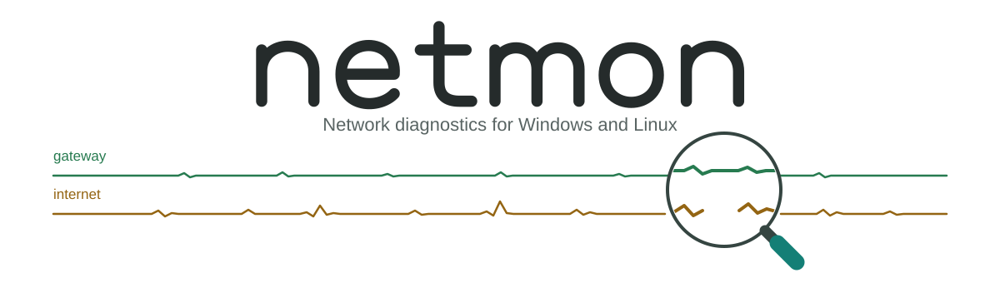
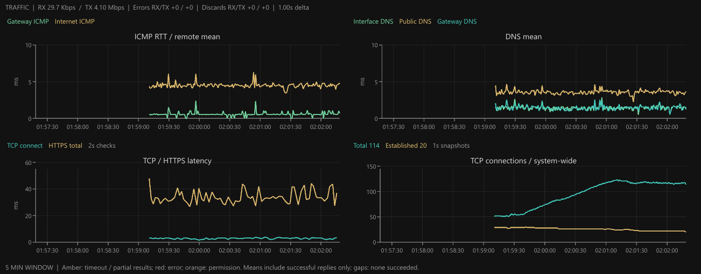
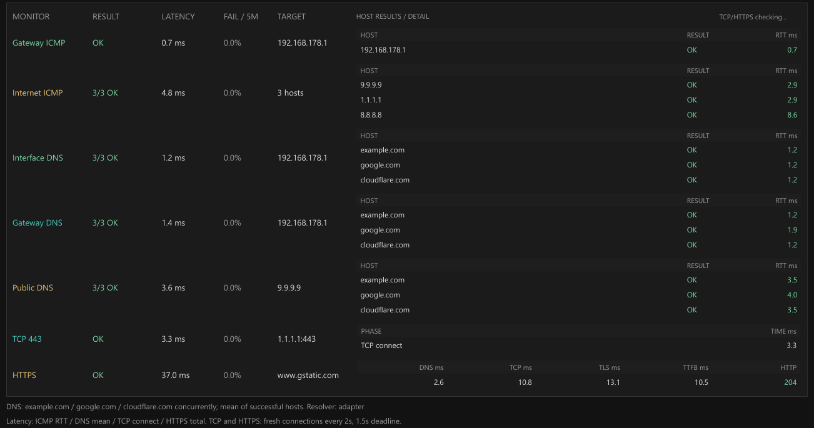

<picture>
  <source media="(prefers-color-scheme: dark)" srcset=".github/banner.svg">
  <source media="(prefers-color-scheme: light)" srcset=".github/banner-light.svg">
  
</picture>

A lightweight, dark-themed network diagnosis dashboard for Windows and Linux. Monitoring starts automatically and follows network changes, with no configuration file, interface selection or server setup.



[View full dashboard](.github/full.png)

## Get started

Download a prebuilt binary from [GitHub Releases](https://github.com/coalaura/netmon/releases) and launch it in a desktop session. Close the window to stop monitoring and flush the log.

### Build from source

Requires Go 1.27.2 or newer. From the repository directory:

```sh
go build .
```

No CGO is required. Run the resulting `netmon.exe` on Windows or `./netmon` on Linux.

## What it monitors

- **ICMP:** gateway latency and remote pings to `9.9.9.9`, `1.1.1.1` and `8.8.8.8`.
- **DNS:** resolution of `example.com`, `google.com` and `cloudflare.com` through the interface's resolver, `9.9.9.9` and the gateway when it supports DNS.
- **Interface:** the OS-selected interface for reaching `9.9.9.9`, its source address, link state and reported speed, gateway neighbor/ARP state and default-route availability.
- **Traffic:** passive receive/transmit rates and interface error/discard counters, read from the OS without generating test traffic.
- **TCP / HTTPS:** a TCP connection to `1.1.1.1:443` and an HTTPS request to `https://www.gstatic.com/generate_204`, with DNS, connection, TLS and time-to-first-byte timings and explicit failure stages.
- **TCP connections:** passive one-second snapshots of total and established TCP socket entries across the system, including IPv4 and IPv6. Linux counts cover the current network namespace.
- **Traceroute:** a background trace to `9.9.9.9` approximately every 20 seconds, with per-hop addresses and RTTs, route changes and a one-hour destination hop-count chart.
- **History:** five-minute latency charts, rolling failure rates, recent state changes and continuous CSV logging.

ICMP and DNS checks run concurrently, roughly once per second, with an 800 ms deadline per probe. Active probes currently use IPv4 only.

TCP and HTTPS checks run concurrently in the background approximately every two seconds, each with a 1.5-second total deadline. HTTPS uses the interface's resolver and a fresh, source-bound connection with certificate validation; it expects HTTP 204, does not follow redirects and closes after reading the response headers. These are direct checks without a proxy or a bulk download.

## Reading the dashboard

### Latency and connections

- Remote ICMP and DNS charts show the **mean of successful replies**. Read these alongside success counts and per-target results: losing a slower target can lower the mean even when connectivity worsens.
- Amber chart bands indicate timeouts or partial results, red indicates errors and orange indicates permission problems. Samples with no successful replies leave gaps rather than plotting zero latency.
- TCP and HTTPS share the Monitor table with ICMP and DNS. The second graph row shows TCP connection latency and HTTPS total latency on the left and total/established TCP counts on the right. All four graphs use the same rolling five-minute window and markerless lines. HTTPS phase timings remain in the table; totals include DNS, TCP, TLS and HTTP.
- TCP counts are current socket-table snapshots, not cumulative attempts or an interface-specific measurement. Totals exclude listening and closed sockets but include `TIME_WAIT` and other closing states; established is a subset. Netmon's own checks also contribute to these counts. Unavailable count samples leave gaps; a measured zero remains zero.

### Per-host results and statistics

The Monitor table brings success counts, latency and failure rates together with individual host results and HTTPS phase timings.



Host results use compact nested tables with one row per host and aligned result/latency columns. **Stats** switches these to separate, right-aligned p50, p95, jitter and loss columns for the last five minutes on the current interface/address and target. TCP/HTTPS use the same statistics layout, with HTTPS phase timings in a separate sub-table and failure details below it. Timings use successful replies only; jitter is the mean absolute change between consecutive successful samples, excluding gaps. Small samples, particularly p95, should be interpreted cautiously.

### Network state and changes

- Traceroute reports a destination hop count only when the destination responds. `*` means no reply; hop RTT is the round trip to that router, not the latency of an individual link.
- Link speed is adapter-reported, not measured throughput. A stale ARP entry is normal. ICMP responses can be filtered or rate-limited, so compare them with DNS and interface status.
- Traffic rates use the actual interval between counter reads. Error/discard increments are interface-wide OS counters, not remote packet-loss measurements. Interface changes and counter resets establish a new baseline instead of producing a spike.
- **Freeze display** holds the displayed snapshot while sampling, state-change detection and CSV logging continue. **Resume live** immediately catches up to the latest state. Recent Changes keeps the newest 32 events, one line each, with horizontal and vertical scrolling.
- Traceroute entries in Recent Changes are change-driven: an initial result, failure/recovery, changed failure reason, network/target change, hop-count change or observed path change. Repeated identical outcomes and timing-only fluctuations do not add entries; every trace still reaches the graph history and CSV.

## CSV logs

Each launch creates a unique `netmon-<timestamp>.csv`. The dashboard shows its path and provides an **Open CSV** button.

| Platform | Log directory |
| --- | --- |
| Windows | `%AppData%\netmon\logs\` |
| Linux | `$XDG_CONFIG_HOME/netmon/logs/` or `~/.config/netmon/logs/` |

Logs include network state, monitor summaries, individual ping and DNS results, traceroute summaries and hops, passive traffic counters and TCP/HTTPS checks. Filter by `record_type` when calculating statistics to avoid counting both summaries and individual results.

Schema version 6 writes 19 rows per regular sample: five `summary`, three `ping`, nine `query`, one `traffic` and one `connections`. Each application-check batch adds two `application` rows; traces add `trace` and `trace_hop` rows. Traffic records contain cumulative counters, interval deltas and rates. Application records contain the failed/completed stage, phase timings, HTTP status, remote address and completion time. Connection records add `tcp_total` and `tcp_established`, with system-wide scope despite the accompanying interface snapshot. Unknown or unattempted measurements are blank; measured zero values remain zero.

Rows are flushed after each sample or completed background check. Logging errors appear in the dashboard while monitoring continues. Logs are not automatically rotated or deleted.

## Platform notes

- **Windows:** uses native network discovery and ICMP traceroute.
- **Linux:** uses netlink and sysfs for network discovery and systemd-resolved for per-interface DNS with `/etc/resolv.conf` as a fallback. ICMP tries unprivileged ping sockets, then raw sockets; if both are denied, the dashboard reports a permission error while other monitors continue. Traceroute uses UDP without requiring raw-socket privileges. **Open CSV** requires `xdg-open`.

DNS servers and local stubs may return cached answers. Windows ICMP and Linux UDP traceroutes can follow different paths or encounter different filtering.
